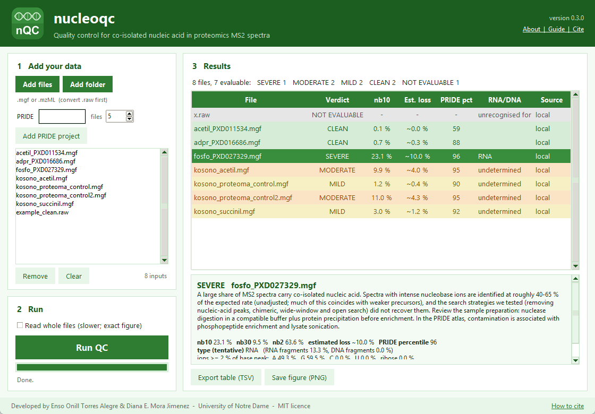

# nucleoqc

Quality control for proteomics: detects **co-isolated nucleic acid** in MS2 spectra, estimates its effect on peptide identification, gives a tentative RNA/DNA call, and flags runs whose sample preparation should be revised.

When a lysate retains DNA or RNA, fragments co-elute with peptides, are co-isolated in the precursor window and release nucleobase ions (adenine 136.0618, guanine 152.0567) in the MS2 spectra. Detection by nucleic-acid marker ions was introduced by Potel et al. (2018, *Mol Cell Proteomics*). In a random sample of evaluable PRIDE projects, about 8 % show it without an experimental reason. Spectra with intense nucleobase ions are identified less often, and in the most contaminated files the estimated identification deficit reaches 25–69 % depending on adjustment. None of the search strategies we tested (removing the peaks, chimeric, wide-window and open search) recovered it, so it is best caught **in the first runs** and fixed in the sample.

`nucleoqc` does not identify peptides and needs no database. It reads 12 MB per file and takes seconds.

## Installation

**Windows, without Python:** download `nucleoqc-0.3.0-windows.zip` from the [Releases](https://github.com/Enso-bio/nucleoqc/releases) page, unzip it and double-click `nucleoqc.exe` inside the `nucleoqc` folder. The program is not digitally signed, so Windows SmartScreen may show "Windows protected your PC": click **More info → Run anyway**. Computers with Smart App Control or institutional application-control policies may block it; on those, install with pip as below.

**With Python (Windows, macOS, Linux):**

```bash
pip install git+https://github.com/Enso-bio/nucleoqc              # numpy only
pip install "nucleoqc[figure] @ git+https://github.com/Enso-bio/nucleoqc"   # with matplotlib for --figure
```

From a downloaded copy: `pip install .` (or `pip install ".[figure]"`) in this folder. Python ≥ 3.8.

## Desktop application



After installing, open the application with

```bash
nucleoqc-gui
```

(or `python -m nucleoqc.gui`, which also works where Windows blocks unsigned launchers). Add files, a folder or a PRIDE accession, press **Run QC**, and click a result to see every metric and what to do. The table and a figure can be exported. **Help → Try the example files** runs two demo files, **Help → Quick guide** explains the verdicts, and **Help → About** lists the authors and how to cite. The application runs the same measurement as the command line and needs nothing beyond Python's standard Tkinter.

## Try it offline (10 seconds)

```bash
python examples/make_examples.py           # writes two small synthetic MGF files
nucleoqc examples/                         # example_clean.mgf -> CLEAN, example_contaminated.mgf -> SEVERE
```

## Usage

```bash
nucleoqc run1.mgf run2.mzML
nucleoqc runs_folder/ --tsv qc.tsv --figure qc.png
nucleoqc PXD023674 --max-files 3          # public PRIDE files, read without downloading them entirely
```

Real output of `nucleoqc PXD023674 --max-files 2` (a public phosphoproteome):

```
SEVERE         Katy_phospho_1a_R.raw.-1.mgf                  nb10  92.7 %  nb2  97.6 %  estimated loss ~53.8 %  PRIDE percentile 100  type (tentative): RNA
SEVERE         Katy_phospho__4d_R.raw.-1.mgf                 nb10  90.3 %  nb2  97.2 %  estimated loss ~51.5 %  PRIDE percentile 100  type (tentative): RNA
```

The exit code is 1 if any file is SEVERE (useful in pipelines), 0 otherwise, and 2 if there was nothing to evaluate.

Input: uncompressed MGF or mzML (centroid or profile; zlib yes, numpress no). Convert .raw files first with `msconvert` (ProteoWizard) or ThermoRawFileParser.

## What it reports

| Column | Meaning |
|---|---|
| `verdict` | CLEAN < 1 % ≤ MILD < 5 % ≤ MODERATE < 20 % ≤ SEVERE (by nb10), or NOT EVALUABLE |
| `nb10` | fraction of MS2 spectra in which adenine or guanine reaches ≥10 % of the base peak (±5 mDa after recalibration) |
| `nb30`, `nb2` | the same with 30 % and 2 % thresholds |
| `estimated_loss` | approximate fraction of identifications lost (see below) |
| `pride_percentile` | fraction of PRIDE projects (random atlas, n = 406) with a lower nb10 |
| `type`, `rna_fragments`, `dna_fragments` | tentative call: RNA / DNA / mixed / undetermined, from nucleotide fragments specific to each |
| `A2 G2 C2 U2 ribose2` | fraction of MS2 spectra with each ion ≥2 % of the base peak |
| `ppm` | global mass offset corrected |
| `cov136`, `hires` | validity tests |

**Why adenine and guanine.** On fragmentation, nucleic acids release protonated purines far more readily than pyrimidines. In 38 searched PRIDE files, adenine and guanine appeared in a median 35 % and 33 % of MS2 spectra of contaminated files (≤0.06 % in clean files); cytosine was about seven times weaker and free uracil and thymine did not exceed chance; adding them would add a median 0.6 % of spectra. Cytosine and uracil ions (112.05, 113.03) also lie below the 120 Th first mass used in many acquisitions (12 of those 38 files).

**RNA or DNA.** Nucleoside-monophosphate fragments (−H₂O) that only one type can produce: GMP, CMP, UMP for RNA (346.055, 306.049, 307.033) and dAMP, dCMP, dTMP for DNA (314.065, 290.054, 305.053). A type is called when one class is at least twice as frequent as the other and present in ≥0.5 % of MS2 spectra. AMP−H₂O (330.060) is not used because dGMP has the same formula. In 38 files: RNA in 9, DNA in 1, mixed in 2, undetermined in 8 contaminated files, and undetermined in all 18 clean files. The call is a threshold rule on fragment signatures and has not been checked against samples of known composition; treat it as indicative.

**Validity.** A file is NOT EVALUABLE when its MS2 spectra do not record m/z < 136, or when they are low-resolution: then adenine (136.0618) cannot be told from the tyrosine immonium ion (136.0757). The test requires ≥70 % of five reference ions (L/I, H, F immonium; K and R y₁) within ±5 mDa, which excludes ion-trap MS2.

**Estimated loss.** Uses the dose-response measured with Sage in 18 contaminated PRIDE files, comparing spectra with nucleobase against control spectra (nucleobase < 0.1 % of base peak) in the same file and the same 20 Th precursor window: 0.70 of the expected rate for nucleobase 10–30 % of base peak, 0.38 for ≥30 %, no appreciable loss below 10 %. The estimate is Σ fraction × (1 − ratio). It assumes that, without contamination, every intensity band would be identified at the same rate as the rest of the file, and it uses unadjusted ratios: most of the association coincides with weaker precursors (matched on precursor intensity, the ratio was 0.81–0.90 instead of 0.39), and model-adjusted deficits are about half. Read it as an approximate deficit, not as identifications a cleaner sample would certainly recover.

**Partial reading.** Three 4 MB chunks (25, 50, 75 % of the file) were compared with 14 whole files: same contaminated/clean status in 14 of 14, same verdict in 13 of 14 (Spearman 0.996), but high nb10 values can be somewhat higher than the whole-run value. Use `--whole` for local files when the exact figure matters.

## Validation

- **Unit tests** (`pytest tests`, 19 tests) with synthetic spectra: Tyr immonium is not counted as adenine; low-resolution files and files without low masses are rejected; recalibration; loss estimate; RNA/DNA call; the most intense peak within the tolerance is used; MS3 scans are not read as MS2; MGF/mzML readers, including chunks that cut spectra.
- **Reproduces the atlas** ([validation/validate.py](validation/validate.py), [results](validation/validation_results.txt)): 16 random PRIDE files re-downloaded and re-measured; nb10 within 0.005 points and same verdict in 16 of 16.
- **Independent validation** ([paper/validation_independent.py](paper/validation_independent.py), [paper/validation_extended.py](paper/validation_extended.py), [paper/nucleoqc_calibration.py](paper/nucleoqc_calibration.py)): 44 files from projects never used for calibration; 33 with a valid search (24 contaminated from 22 projects, 9 clean; 12 species). The loss was estimated before searching with Sage.

  | | |
  |---|---|
  | Pearson r (95 % CI, bootstrap by project) | 0.93 (0.68–0.99) |
  | Spearman | 0.86 (0.71–0.95) |
  | Calibration line | measured = −0.4 + 1.06 × estimated (slope 0.44–1.27) |
  | Median absolute error | 0.7 points |
  | Clean controls | 9 of 9 below 0.15 % estimated and measured |

  The slope interval is wide because few files had large losses. The largest errors were a human ChIP-MS file (11.8 % estimated, 0.7 % measured) and a phosphoproteome (30.5 % vs 14.1 %).

## Limitations

- It only detects nucleic acid that **fragments** into nucleobases; this is usual with high-resolution HCD/CID, untested with ETD/EThcD.
- ADP-ribosylation, protein–RNA cross-linking, ChIP-MS and ATP assays give signal **by design**; in those studies it is not contamination.
- The loss estimate comes from Sage searches (1 % FDR); the effect was smaller with Comet, and may differ with other engines or sample types.
- MGF files that only contain peaks above ~150 Th (some filtered exports) are NOT EVALUABLE.

## How to cite

If you use nucleoqc, please cite the article:

> Torres Alegre EO, Mora Jimenez DE. Co-isolated nucleic acid in public proteomics data: prevalence, association with peptide identification, and a quality-control tool. 2026.

GitHub's **Cite this repository** button (from [CITATION.cff](CITATION.cff)) gives this reference in APA and BibTeX. `nucleoqc --cite` prints it too. Please cite the article rather than this repository; if you need to record the exact version, mention the release tag (for example v0.2.1).

## Reproducing the paper

The analysis scripts and the supplementary tables of the article are in [paper/](paper/), with a table mapping each script to the figure or table it supports.

## Licence

MIT.
